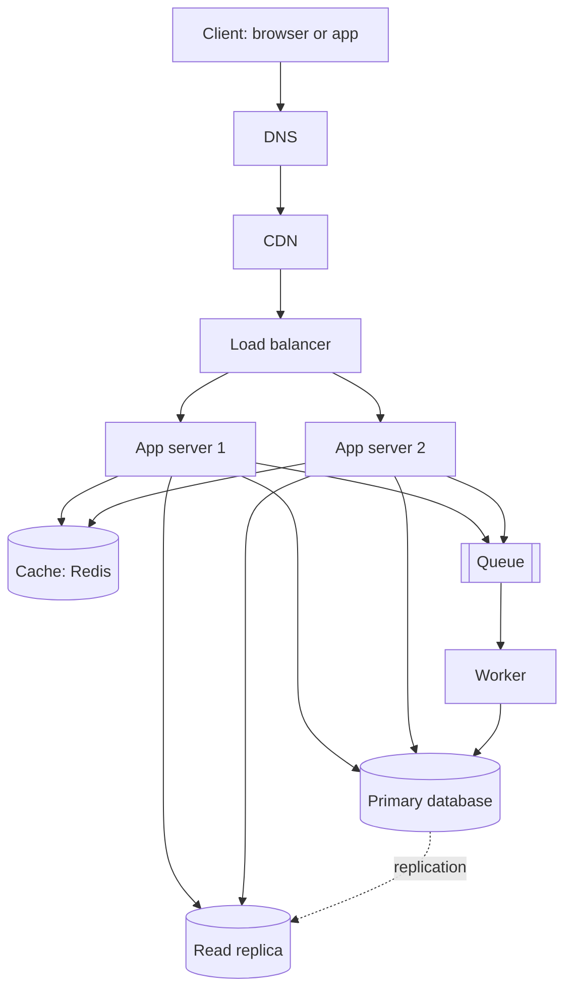

# QuickNotes Architecture

## Requirements

### Functional
- Users can sign up and log in.
- Users can create, read, update and delete their own notes.
- Users can tag notes and filter notes by tag.
- Notes are listed newest first, with pagination.
- Notes sync across a user's devices.

### Non-functional
- **Scale:** 1 million registered users.
- **Availability:** 99.9% uptime (about 8.8 hours of downtime per year at most).
- **Latency:** listing notes in under 200 ms (95th percentile).
- **Durability:** a saved note is never lost (backups plus replication).
- **Security:** HTTPS everywhere, hashed passwords, users can only see their own notes.
- **Scalability:** add servers without redesigning.

## Load estimate (1 million users)

Assumptions: 30% of users are active each day (300,000), each doing 30 reads and 3 writes per day, peak traffic 5× the average, and an average note of about 1 KB including metadata.

| Metric | Calculation | Result |
|--------|-------------|--------|
| Reads per day | 300,000 × 30 | 9,000,000 |
| **Reads per second** | 9,000,000 ÷ 86,400 | **~105 average, ~520 peak** |
| Writes per day | 300,000 × 3 | 900,000 |
| **Writes per second** | 900,000 ÷ 86,400 | **~10 average, ~52 peak** |
| New notes per year | 900,000 × 365 | ~329 million |
| **Storage per year** | 329 million × 1 KB | **~330 GB** (about 1 TB with indexes and replica) |

Reads outnumber writes about 10 to 1, so caching and a read replica give the biggest gain.

## Architecture diagram

## Why each component exists

- **Client:** the web or mobile app where users read and write notes.
- **DNS:** turns `api.quicknotes.com` into the address of the CDN or load balancer, so we can move servers without users noticing.
- **CDN:** serves static files (HTML, CSS, JS) from locations near the user, which cuts latency and takes load off our servers.
- **Load balancer:** spreads requests across app servers and stops sending traffic to servers that fail health checks.
- **App servers (2 or more):** run the API logic; they are stateless, so we scale by adding more of them.
- **Cache (Redis):** keeps recent note lists in memory so most reads skip the database.
- **Primary database:** the single source of truth that receives all writes.
- **Read replica:** a live copy that serves read queries, so reads do not slow down writes, and it can replace the primary if that fails.
- **Queue:** accepts background jobs instantly so a slow task never makes the user wait.
- **Worker:** takes jobs from the queue and runs them (search indexing, sync notifications, cleanup).

## Request flows

### GET /notes
1. The client resolves the API hostname through **DNS**.
2. The request goes through the **CDN**, which passes API calls straight to the origin (private data is not cached there).
3. The **load balancer** picks a healthy app server.
4. The app server checks the token (401 if invalid).
5. It looks for `notes:{userId}:{cursor}` in the **cache**.
6. **Cache hit:** return the stored JSON right away.
7. **Cache miss:** query the **read replica**, store the result in the cache for 60 seconds, then return it.
8. The server responds `200 OK` with the list.

### POST /notes
1. DNS, CDN and load balancer route the request to an app server as above.
2. The app server checks the token and validates the body (title required, max 100 characters; 400 if not).
3. It writes the note to the **primary database** in one transaction.
4. It deletes the user's cached note lists, so the next read is fresh.
5. It puts a `note.created` job on the **queue**.
6. It responds `201 Created` with the new note and a `Location` header.
7. A **worker** later takes the job and does the slow work (search index, notify other devices); if it fails, the job is retried.

## Trade-offs

1. **Consistency vs speed.** The cache (60 s) and the replica (small replication lag) can show slightly old data. We accept this because notes are rarely edited from two places at once, and we clear the cache after writes so the user's own changes show up quickly.
2. **Simple writes vs background work.** The queue makes `POST /notes` fast, but things like search indexing become eventually consistent (a few seconds late) and we must run and monitor workers.
3. **Cost vs availability.** Two or more app servers, a replica and a cache cost more than one server, but a single server would take the whole service down when it fails.
4. **One primary database vs sharding.** A single primary is simple and handles about 52 writes per second easily; the cost is a hard limit later, which we handle by sharding on `user_id` only when needed.

## Avoiding single points of failure

- **App servers:** two or more across different availability zones, so one failure does not matter.
- **Load balancer:** use a managed, redundant load balancer (or an active/passive pair).
- **Database:** the read replica can be promoted to primary automatically if the primary fails; regular backups protect against data loss.
- **Cache:** Redis with a replica; if it fails, requests fall back to the database (slower but working).
- **Queue and workers:** a durable, replicated queue keeps jobs safe; several workers run in parallel and failed jobs are retried.
- **DNS and CDN:** managed services with many locations; a second DNS provider can be added.
- **Monitoring:** health checks and alerts so failures are noticed and fixed quickly.
